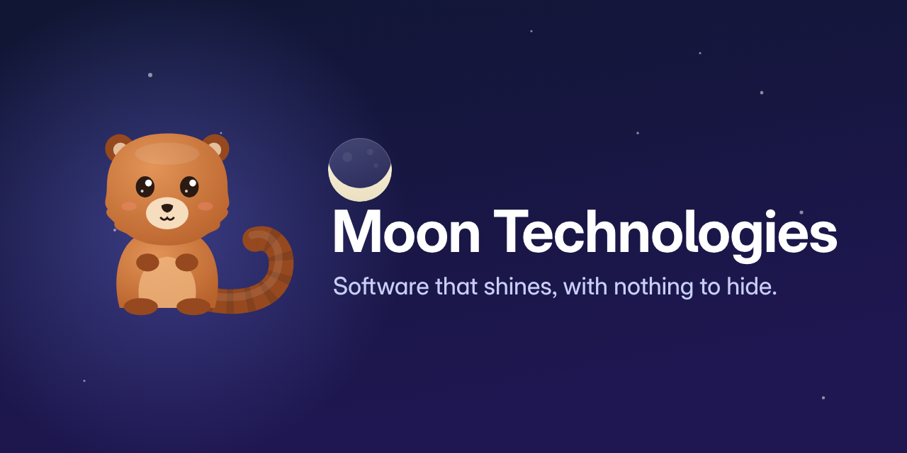

  

<h3 align="center">Software that shines, with nothing to hide.</h3>

  <a href="https://moon-technologiesco.github.io"><b>Website</b></a> ·
  <a href="https://github.com/Moon-TechnologiesCO/moon-fonts"><b>Moon fonts</b></a>

---

**Moon Technologies** is a Colombian software company. We design and build secure, local-first,
beautifully crafted software for people and businesses — and we share much of it with the world as
free software through **Moon Open Source**.

### 🌙 Moon Open Source — *free software, made with love in Colombia*

| Project | What it is | Status |
|---|---|---|
| [**MoonCam**](https://github.com/Moon-TechnologiesCO/MoonCam) | Your Android phone as a webcam and microphone for Linux: virtual camera, virtual mic, noise suppression, private by design. | In development |
| [**Star Language**](https://github.com/Moon-TechnologiesCO/StarLang) | A modern, space-themed programming language with OOP and a VS Code extension. | Available |
| [**Star Studio**](https://github.com/Moon-TechnologiesCO/StarStudio) · [**Star Packages**](https://github.com/Moon-TechnologiesCO/StarPackages) | Editor tooling and installers (APT, PowerShell, Homebrew) for Star. | Available |
| [**NixPlay**](https://github.com/Moon-TechnologiesCO/NixPlay) | A Linux-first game platform for Windows, Android and native Linux games. | Early stage |
| [**Ideora**](https://github.com/Moon-TechnologiesCO/Ideora) | An infinite canvas for UML diagrams and flowcharts. | Available |
| [**Moon fonts**](https://github.com/Moon-TechnologiesCO/moon-fonts) | Moon Sans, Moon Serif and Moon Mono — our type family, Thin to Black with italics. | Available |

### Our principles

**Transparency** · **Privacy first** · **Craft** · **Warmth** · **Community** · **Constancy** —
six principles, one moon. Read why on [our website](https://moon-technologiesco.github.io/#principles).

### Meet Lino

Our mascot is an olinguito: a small night animal from the cloud forests of the Colombian Andes,
described by science only in 2013. He comes out when the moon does — and his name carries a wink:
o-**LIN**-guito, like Linux.

---

Moon Technologies · Colombia · Contributions are welcome — see our
<a href="https://github.com/Moon-TechnologiesCO/.github/blob/main/CONTRIBUTING.md">contributing guide</a> and
<a href="https://github.com/Moon-TechnologiesCO/.github/blob/main/CODE_OF_CONDUCT.md">code of conduct</a>.
